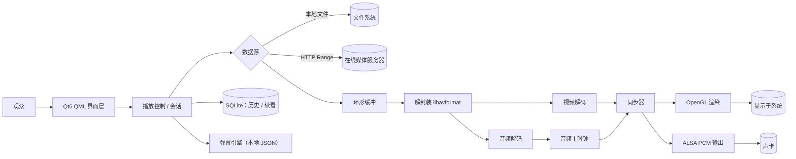

# 多功能流媒体播放器（Qt6 / C++ / QML）

一个运行在 Manjaro 桌面上的流媒体播放器：既能看本地视频，也能通过 HTTP 边下边播在线视频；
画面走自研 OpenGL 渲染，声音走 ALSA PCM 输出，两者由自研的音频主时钟同步；在此之上提供
播放控制、本地媒体库、断点续看与弹幕。

> **整条播放链路不使用 Qt 多媒体组件与任何高层播放器库**——解封装、解码调度、音画同步、
> 渲染与音频输出全部自行实现。

---

## 项目状态

项目处于**需求阶段**，仓库当前只包含需求文档，源码尚未合入。

| 部分 | 状态 | 说明 |
|---|---|---|
| 需求规格说明书 | ✅ v0.1 | 见 [`docs/`](docs/) |
| 总体架构设计 | 🚧 进行中 | 模块边界与线程模型待定稿 |
| 播放内核（解封装 / 解码 / 同步） | ⬜ 未开始 | |
| 视频渲染（OpenGL）与音频输出（ALSA） | ⬜ 未开始 | |
| Qt Quick 界面与媒体库 / 历史 | ⬜ 未开始 | |
| 弹幕 | ⬜ 未开始 | |

---

## 为什么要做

现有的观看方式把"本地播放"和"在线播放"拆在两个工具里：系统播放器看文件、浏览器看在线内容，
进度和偏好互不相通；而通用播放器普遍封装了平台多媒体组件，链路是黑盒，没法针对低配设备
调优起播与缓冲。

本项目把这件事收敛到一个客户端里，并且把播放链路自己实现一遍。三条目标：

- **G1 本地与在线一体化**：同一个客户端完成本地播放与在线边下边播，进度与偏好延续。
- **G2 播放内核自主可控**：自行完成解封装、解码、音画同步、渲染与 PCM 输出，不依赖被禁组件。
- **G3 轻量互动与观看延续**：弹幕显示 / 开关 / 发送，配合观看历史与断点续看。

## 功能范围

### 本期实现（Must）

| 编号 | 用况 | 关键点 |
|---|---|---|
| UC-01 | 播放本地视频文件 | mp4 / mkv，H.264 + AAC |
| UC-02 | 播放在线视频 | HTTP Range 渐进式边下边播，环形缓冲与缓冲提示 |
| UC-03 | 控制播放过程 | 播放 / 暂停 / 停止 / 拖动 / 音量 / 静音 / 全屏 |
| UC-04 | 管理本地媒体库与播放列表 | 目录扫描、列表编辑 |
| UC-05 | 观看历史与断点续看 | SQLite 持久化，位置误差 ≤ 1 s |
| UC-06 | 发送与显示弹幕 | 本地 JSON 数据源，滚动 / 开关 / 发送 |

### 有余力再做（Should）

倍速播放（含 atempo 变调保护）、外挂字幕、收藏、本地库内关键词过滤。

## 技术方案



| 环节 | 选型 | 说明 |
|---|---|---|
| 解封装 / 解码 | FFmpeg `libav*`（6.x） | 只做编解码，不做同步与调度 |
| 音画同步 | 自研，音频主时钟 | 视频帧按音频时钟对齐；丢帧 / 等待策略自定 |
| 视频渲染 | OpenGL（FBO + shader） | 保底档 `swscale + QImage` 先跑通，再切 YUV 直传 |
| 音频输出 | ALSA PCM | 设备被占用时降级 PulseAudio 或静音播放 |
| 界面 | Qt 6 / QML | 业务层与播放内核通过接口隔离 |
| 本地存储 | SQLite | 观看位置、偏好 |
| 弹幕 | 本地 JSON（`time` / `mode` / `color` / `text`） | 后期可换简易静态服务，接口不变 |

## 目录结构

```
.
├── docs/                                   # 需求文档
│   └── 多功能流媒体播放器需求规格说明书v0.1.docx
├── src/                                    # 规划中：源码
│   ├── core/                               #   解封装 / 解码 / 同步 / 缓冲
│   ├── render/                             #   OpenGL 渲染
│   ├── audio/                              #   ALSA / PulseAudio 输出
│   ├── data/                               #   媒体库、历史、弹幕
│   └── ui/                                 #   QML 界面
├── tests/                                  # 规划中：测试片源与用例
└── CMakeLists.txt                          # 规划中：构建入口
```

---

## 环境要求

- 操作系统：Manjaro Linux（PipeWire / PulseAudio 均可）
- 编译器与构建：GCC 13+、CMake 3.21+
- 依赖库：Qt 6（Base / Quick / OpenGL）、FFmpeg 6（`libavformat` / `libavcodec` /
  `libavutil` / `libswscale` / `libswresample`）、ALSA（`libasound2`）、SQLite3、Mesa

## 构建与运行

首个可运行版本合入后会在此补上完整步骤（预期为 `cmake -B build && cmake --build build`
之后运行生成的二进制）。当前仓库尚无源码，暂无可执行的构建流程。

---

## 文档

- [需求规格说明书 v0.1](docs/多功能流媒体播放器需求规格说明书v0.1.docx)（Word，含目标分析、
  涉众分析、用况模型、需求清单与追溯矩阵）
- 后续设计文档（架构、线程模型、同步策略）计划以 Markdown 形式放于 `docs/`

---

## 团队分工

| 分工 | 负责 |
|---|---|
| 播放内核 | FFmpeg 解封装解码、音画同步、OpenGL 渲染、ALSA 输出 |
| UI 与业务 | Qt Quick 界面、媒体库与历史、弹幕展示与交互 |
| 需求与统筹 | 需求文档、涉众访谈、追溯矩阵、测试与验收 |

三人小组课程项目，按周迭代，每轮对齐一次"新增需求能否追溯到目标、范围是否漂移"。

---

## 里程碑

| 阶段 | 产出 |
|---|---|
| M1 需求 | 需求规格说明书 v0.1（已完成） |
| M2 最小闭环 | 本地 H.264 文件播放：解封装 → 解码 → 软渲染上屏 |
| M3 声音与同步 | ALSA 输出、音频主时钟、音画同步偏差可测量 |
| M4 在线播放 | HTTP Range 边下边播、环形缓冲、缓冲提示 |
| M5 体验完善 | 媒体库、断点续看、弹幕、全屏与快捷键 |
| M6 验收 | 指标测试（起播、同步、长跑、畸形文件）、文档定稿 |

---

## 说明

本项目为课程作业，需求文档仍在迭代（当前 v0.1）。README 会随实现进度更新；
接口与目录结构在 M2 合入前可能调整。
